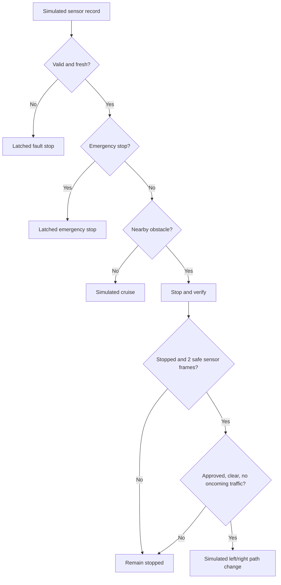

# MForce — Automated Vehicle Safety Simulator

**A GitHub-ready, software-only prototype for rule-based vehicle automation.**

MForce explores an automated vehicle decision pipeline: simulated sensor inputs → validation → deterministic safety controller → decision/state → desktop visualization and CSV evidence. The example scenario models a **six-wheeler truck ahead**: stop first, validate a permitted alternate route over multiple fresh sensor frames, shift left/right only when the simulated conditions permit, or remain stopped when uncertain.

> **SAFETY:** This is an educational **simulator**, not a real autonomous-driving system. It has no actuator interface, cannot operate a road vehicle, and is not a verified ADAS/AV controller. No safety guarantee applies to real-world use. Read [Safety and limitations](docs/SAFETY.md).

## What works (version 0.1.0)

- Tkinter desktop simulator with a step-by-step interface (no pip packages required).
- State machine for `CRUISE`, `WAIT_STOP`, `CHANGE_LEFT`, `CHANGE_RIGHT`, `FAULT_STOP`, and `EMERGENCY_STOP`.
- Obstacle proximity / sensor confidence checks; moving vehicles must stop before simulated path changes.
- Alternate paths require **two consecutive good sensor frames**, lane permission, clearance, reliable sensing, and no oncoming traffic.
- Latching emergency and sensor-fault stop states; reset is explicit.
- Twelve reproducible JSON scenarios and Python `unittest` regression tests.
- CSV of simulation decisions for demonstrations and assessments.
- GitHub Actions CI runs unit tests on every push and pull request.

## Quick start (Windows, minimal terminal use)

1. Install **Python 3.11+** with Tkinter and, ideally, GitHub Desktop. Python 3.13 also works with this project.
2. Download and **Extract All** `MForce_GitHub_Ready.zip` into your chosen OneDrive folder. Open the **MForce** folder (not the ZIP).
3. Double-click **`START_MFORCE.bat`** to launch the visual simulator.
4. Choose a scenario. Press **Next frame** to inspect each decision or **Run** for a short sequence.
5. Double-click **`TEST_MFORCE.bat`** for a quick automated test + CSV run.

No internet connection, AI model download, CUDA, ROS, or extra Python packages are needed for this version. If `.bat` files are blocked by local policy, use the alternative commands below.

### Optional command line (ONE terminal only)

Open PowerShell *in the MForce project folder* and run:

```powershell
python -m mforce                # desktop GUI
python -m mforce demo           # runs 12 scenarios, exports output/demo_results.csv
python -m mforce test           # regression tests
```

If Windows recognizes `py` instead of `python`, use `py -3 -m mforce ...`.

## How it works



**Important:** The `CHANGE_LEFT` / `CHANGE_RIGHT` decisions are labels for simulation only; there are **no steering, throttle, or brake commands**. Camera perception, dynamic object tracking, road maps, traffic laws, obstacle prediction, real control loops, and physical validation are **not** implemented.

## Folder overview

```text
MForce/
├── START_MFORCE.bat                # double-click to run GUI
├── TEST_MFORCE.bat                 # double-click to test + create evidence CSV
├── README.md                       # GitHub landing page
├── pyproject.toml                  # simple metadata; no dependencies
├── .gitignore                      # prevents machine files/data from committing
├── .github/workflows/tests.yml     # CI checks after push
├── mforce/
│   ├── __main__.py                 # CLI entry points
│   ├── models.py                   # strict input validation and decision types
│   ├── controller.py               # deterministic safety state machine
│   ├── scenarios.py                # JSON scenario loader
│   └── gui.py                      # Tkinter visualization
├── data/scenarios/                # 12 simulation cases, committed to GitHub
├── tests/                         # automated regression tests
├── evidence/sample_demo_results.csv # tracked demonstration evidence
├── VERIFICATION.md                  # local validation details
├── docs/
│   ├── ARCHITECTURE.md
│   ├── SAFETY.md
│   ├── GITHUB_UPLOAD.md
│   └── RESUME.md
└── output/                        # created automatically; ignored by Git
```

## Roadmap (not implemented yet)

1. Object-detection model + labeled dataset for simulated perception.
2. ROS 2 / CARLA / Gazebo simulator adapter with strict safety boundaries.
3. Trajectory planning, velocity estimation, and more rigorous verification.
4. SIL/HIL testing, fault injection, documented validation metrics.
5. **Only after** automotive engineering review: redundant real sensors, formal safety processes, functional safety analysis, and controlled hardware experiments.

This project is **AI-ready**, but the current decision-maker is a **rule-based algorithm, not a trained machine-learning model**. Do not claim deployed autonomous driving or measured ML accuracy in a resume.

## GitHub + resume

See [Publish without terminal](docs/GITHUB_UPLOAD.md) and [Resume-ready project description](docs/RESUME.md). For a recruiter, show the GUI, the scenario tests, the GitHub Actions check, and the CSV evidence, rather than unverified claims of road-ready autonomy.

## Energy concept note

Permanent magnets can be used in electric motors and generators, but **continuous net energy cannot be obtained from magnets and self-rotation alone**. Any future MForce vehicle needs a real external power/energy source and a physically realistic energy budget.
